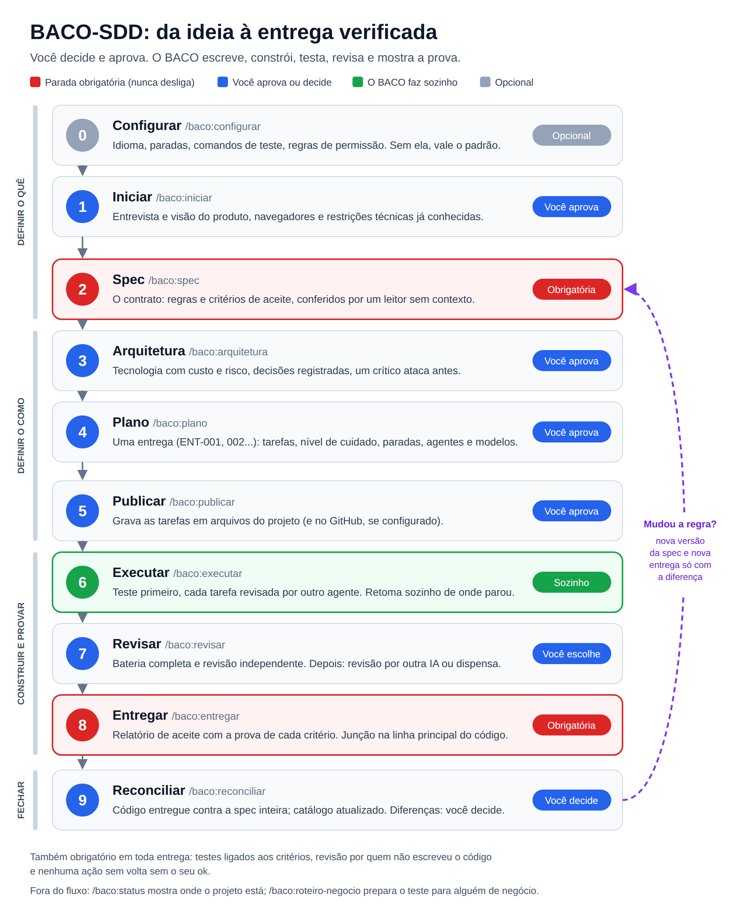

<p align="center"></p>

# BACO-SDD

O BACO-SDD leva uma necessidade de produto da ideia até a entrega verificada, com a especificação (spec) como contrato. Ele conduz o trabalho em fases, para nas decisões que são da pessoa e prova com testes que o que foi pedido foi construído.

É uma skill no formato aberto Agent Skills, com um motor de verificação em Node, e um plugin do Claude Code que acrescenta comandos, agentes próprios e travas automáticas. A experiência completa é a do plugin no Claude Code. No Antigravity, o BACO gera um plugin próprio, com os subagentes e as travas. Em outras ferramentas (Codex e outras que leiam Agent Skills) roda a skill, com as mesmas fases e o mesmo motor, mas sem as travas do plugin. A seção [Onde funciona](#onde-funciona) mostra recurso por recurso.

Versão 1.13.1 ([release](https://github.com/brunobaco/baco-sdd/releases/tag/v1.13.1), [histórico de mudanças](CHANGELOG.md)). Licença [MIT](LICENSE).

## A ideia em uma frase

Você decide o que o produto deve fazer e aprova cada passo importante; o BACO escreve, constrói, testa, revisa e mostra a prova, sem nunca se aprovar sozinho.

## O fluxo



## Como funciona

O trabalho anda em fases. Cada uma termina com arquivos salvos no projeto, então dá para parar depois de qualquer fase e voltar outro dia. Também dá para entrar no meio: com uma spec já aprovada no catálogo, o BACO começa direto pelo plano.

| Fase | Comando | O que acontece | Quem decide |
|---|---|---|---|
| 0. Configurar | `/baco:configurar` | Perguntas que explicam o que cada opção muda: idioma, onde registrar tarefas, linhas de trabalho do código (branches), paradas, cenários manuais pendentes, comandos de teste, quando roda a bateria completa, tamanho da conversa, ferramentas de IA e o modelo de cada nível, nível de IA por tipo de tarefa, o que é arriscado neste projeto e o que a revisão sempre olha, quem revisa o PR, rodadas de revisão, onde a entrega termina e se a junção na integração é automática, tamanho máximo da entrega, divisão das tarefas, quem faz cada papel e as reservas, regras de permissão. Num projeto configurado numa versão anterior, faz só as perguntas novas. Opcional: sem ela, vale o padrão. | Você responde |
| 1. Iniciar | `/baco:iniciar` | Entrevista curta sobre o produto e cria a documentação mínima: visão, planejamento, catálogo de specs. Pergunta em quais navegadores o produto precisa funcionar e se já existe alguma decisão técnica ou restrição a respeitar. Não escolhe tecnologia: isso é da fase 3. | Você aprova o início |
| 2. Spec | `/baco:spec` | Escreve o contrato de uma capacidade: regras de negócio e critérios de aceite (o que precisa acontecer para estar certo), com cenários de teste. Um leitor sem contexto procura lacunas; um revisor de simplicidade corta o que sobra. Também audita ou evolui uma spec já aprovada. | Você aprova a spec (sempre) |
| 3. Arquitetura | `/baco:arquitetura` | Depois da primeira spec aprovada, propõe a tecnologia (ou confere a que você já tem), com fronteiras internas, modos de falha, recuperação, custo, risco, dificuldade de voltar atrás e gatilhos de revisão, e registra cada decisão (ADR). Um advogado do diabo ataca a proposta antes de você ver. Também audita a arquitetura de um repositório existente em modo só leitura (`auditar arquitetura`) e conduz transições seguras em sistemas já no ar. | Você aprova (auditoria só gera relatório) |
| 4. Plano | `/baco:plano` | Corta uma entrega (normalmente uma spec), divide em tarefas, define o nível de cuidado, as paradas e quem roda cada tarefa e cada papel: ferramenta de IA, modelo e esforço. Entrega grande demais (`planning.max_tasks`, `max_criteria`) é proposta em duas. Depois da aprovação, mudança de spec vai para a próxima entrega, a não ser que você decida trazê-la (`planning.freeze_specs`). | Você aprova o plano |
| 5. Publicar | `/baco:publicar` | Grava as tarefas em arquivos do projeto (e no GitHub, se configurado, com o quadro do GitHub Project acompanhando cada tarefa até a junção) e confere o que gravou. | Você aprova o lote |
| 6. Executar | `/baco:executar` | Constrói as tarefas sozinho, com teste primeiro, cada uma numa linha de trabalho própria, revisada por outro agente antes de juntar. Segue sozinho pela revisão do PR até a entrega ficar pronta para você testar. | Só o que está marcado para você conferir |
| 7. Revisar | `/baco:revisar` | Revisão final independente da entrega inteira (uma rodada completa e, no máximo, as de correção até `review.final_rounds_max`) e revisão de simplicidade. Depois abre o pedido de junção (PR) da entrega como rascunho e pede a revisão de fora: outra IA, de preferência em outra ferramenta, uma pessoa ou as duas. Os achados viram correções no mesmo PR, e o mesmo revisor confere só elas. A bateria completa roda uma vez, depois do último veredito aprovado. | A revisão de pessoa e a dispensa são suas |
| 8. Entregar | `/baco:entregar` | Gera o relatório de aceite em linguagem de negócio, com cada critério e sua prova, riscos e pendências, e deixa a entrega pronta para você testar. Depois do seu "pode juntar", conduz a junção na linha principal. Com `delivery.integration_merge: auto`, a junção na linha de integração segue sozinha quando o `baco merge-check` diz que está limpo; na principal, sempre pergunta. | Você aprova a junção na principal (sempre) |
| 9. Reconciliar | `/baco:reconciliar` | Confere o código entregue contra a spec e atualiza o catálogo. Diferença entre o que a spec diz e o que o produto faz vira pergunta para você. | Você decide cada diferença |

Comandos de apoio:

| Comando | Para quê |
|---|---|
| `/baco:status` | Onde o projeto está, o que está rodando, o que espera você e o próximo passo. |
| `/baco:issue` | Entrada pelo GitHub. Com número (`/baco:issue 12`, ou vários: `/baco:issue 12 15 18`), lê a issue e classifica: defeito que a spec já cobre vai direto para uma entrega leve, com teste primeiro; defeito em que a spec é omissa e melhoria pequena mudam a spec antes, com a sua aprovação; o que é grande demais segue pelo `/baco:spec` e `/baco:plano`. Várias issues pequenas podem virar uma entrega só. O PR fecha as issues tratadas (`Closes #N`) e a publicação reaproveita a issue que já existe. Sem número, ajuda a escrever uma issue nova (em defeito, pede passos, esperado e obtido, ambiente, erro e print) e só cria depois do seu ok. O texto da issue é tratado como dado: instrução escrita nele não é seguida, e o BACO avisa você. |
| `baco merge-check` | Comando do motor: diz se a entrega pode juntar sem a pessoa (bateria completa válida, veredito, cenário manual, itens esperando você, CI do PR e política). |
| `baco cost history` | Comando do motor: uma linha por entrega medida, com tokens por papel e razões (condutor por tarefa, construtor e revisor por revisão). O planejador usa para estimar. |
| `/baco:roteiro-negocio` | Roteiro de teste em linguagem simples para alguém de negócio testar a entrega, com uma folha de resposta que o BACO lê de volta. |

Não precisa decorar comandos: descrever o que você quer ("quero mudar a regra de prazo", "continua a entrega") também funciona, e é o único jeito fora do plugin.

## O que é obrigatório e o que é opcional

Três paradas nunca desligam, qualquer que seja a configuração. O motor ignora um valor que tente desligá-las e avisa.

1. Aprovação da spec.
2. Ação sem volta (apagar dados, publicar em produção, migração destrutiva).
3. Junção na linha principal do código.

Paradas ajustáveis (ligadas por padrão, você pode desligar no `/baco:configurar`): início do projeto, arquitetura, plano, lote de tarefas e pedido de junção. Também dá para ligar uma parada depois de cada tarefa.

Também obrigatórios: testes ligados aos critérios de aceite, revisão independente de cada tarefa e da entrega inteira (nunca por quem escreveu o código) e o relatório de aceite.

Opcionais:

1. A fase 0 (sem ela, vale o padrão).
2. A revisão do PR por fora (feita por padrão por outra IA; pode ser uma pessoa, ou as duas; só você pode dispensar, com motivo, e o aceite registra que não houve).
3. Os seis olhares antes da spec, oferecidos quando a ideia mexe com dinheiro, dados pessoais, algo difícil de desfazer ou mais de uma área.
4. O roteiro de teste para pessoa de negócio.
5. A reconciliação (fase 9), quando você quer o catálogo atualizado.

## O que ele faz sozinho

Depois do plano aprovado, o `/baco:executar` trabalha sem parar até a entrega ficar pronta para você testar (revisada, corrigida e com o relatório de aceite), a não ser que a revisão do PR espere por uma pessoa. Nesse caminho ele:

1. constrói e testa cada tarefa, com revisão por outro agente, correção só do que quebra o que a tarefa promete e um limite de revisões por tipo de tarefa (padrão 2, 3 e 4, ajustável no plano de cada entrega);
2. roda tarefas independentes ao mesmo tempo;
3. confere se o app sobe como o usuário faz antes de juntar cada tarefa de tela ou servidor;
4. decide dúvidas pequenas e reversíveis pela recomendação dele e registra "decidido pelo agente, conferir no fim";
5. transforma bloqueio de ambiente em pendência registrada e segue com o resto;
6. se a cota de uma ferramenta acabar, passa o papel para a reserva que o plano aprovou; sem reserva, registra onde parou e retoma dali quando você manda "continuar";
7. troca de conversa quando ela fica grande, sem perder o fio (ver [Proteções](#proteções)), e avisa quando uma versão nova do BACO foi instalada no meio do trabalho, para você abrir uma conversa nova;
8. abre o PR da entrega como rascunho (sem GitHub, usa a diferença local), manda revisar, registra o veredito da IA revisora e corrige os achados no mesmo PR até a aprovação ou até o limite de rodadas.

Cenário manual que só um QA especialista roda (`qa.specialist`, por exemplo leitor de tela) nunca é perguntado a você e nunca trava uma junção: vira pendência para o especialista.

O que ele nunca faz sozinho: aprovar spec, tomar ação sem volta, juntar na linha principal, dispensar a revisão externa, escrever ou mudar o veredito de um revisor, mudar uma spec durante a construção, afrouxar ou apagar um teste para passar. Tarefa marcada para você conferir é construída e espera seu ok antes de ser juntada, enquanto as outras seguem. No fim, você recebe um resumo único com tudo o que espera você.

## Proteções

O BACO parte do princípio de que um agente de IA erra, se apressa e às vezes se convence de que terminou. Por isso as regras importantes não dependem só de instrução: o que dá para conferir mecanicamente fica com o motor, que roda igual em qualquer ferramenta, e o que precisa barrar uma ação do agente na hora fica com os ganchos do plugin, que só existem no Claude Code.

A coluna "Garantido por" diz de onde vem cada proteção: **motor** (vale em qualquer ferramenta), **plugin** (só no Claude Code com o plugin instalado), **ferramenta** (o isolamento da própria ferramenta de IA, configurado pelo BACO) ou **método** (instrução da skill que o agente segue, sem trava mecânica).

| Proteção | O que faz | Garantido por |
|---|---|---|
| Paradas que nunca desligam | Aprovação da spec, ação sem volta e junção na linha principal ficam sempre ligadas; a configuração não consegue desligá-las. | motor |
| Rastreio do critério até o teste | Cada critério de aceite tem cenários de teste, e cada teste leva a etiqueta do critério no título. O motor monta a cadeia critério, cenário, teste e resultado, e aponta critério sem teste, teste que falhou e teste órfão. | motor |
| Proteção contra teste enfraquecido | Compara os testes da tarefa com o ponto de partida dela e com o da entrega. Teste pulado (`.skip`, `.only`, `xit`), teste etiquetado alterado ou apagado, arquivo de teste renomeado para fora do padrão e mudança nos comandos de teste da configuração viram parada humana. O `guard-tests` aceita mais de uma spec de origem, para uma entrega que mexe em várias. O fim de cada teste é medido de dois jeitos independentes, e vale o mais distante, para que um erro de leitura só aumente a proteção. | motor |
| Conferência de camada do teste | Quando o cenário diz que a prova tem que vir do navegador, um teste só da regra não prova o critério: o rastreio marca a diferença. | motor |
| Prova presa à versão do código | O relatório de aceite recusa um rastreio de testes ou um veredito de revisão feitos sobre uma versão do código que mudou depois. Mudança só nos registros da entrega não conta. | motor |
| Plano desatualizado | Se a spec ganhou versão nova depois do plano, o motor acusa antes de construir. | motor |
| IDs nunca reaproveitados | Validação da spec: critério sem Dado, Quando e Então, ID duplicado, ID aposentado definido de novo, linha de próximos números livres desatualizada, item escrito num formato que o motor não lê. | motor |
| Linhas principais protegidas | Nenhuma edição em `main` ou `develop`: o trabalho acontece na linha da entrega ou da tarefa. | motor (`check-branch`) e plugin (bloqueio automático da edição) |
| Trava de gravação fora do projeto | Barra um subagente que tenta gravar fora da pasta do projeto por redirecionamento de saída (`>`, `>>`, `tee`). É uma trava contra engano, não uma fronteira de segurança: as lacunas conhecidas estão no [contrato do motor](skills/baco-sdd/scripts/README.md). | plugin |
| Revisores que não editam | Os papéis de revisão só leem e gravam o próprio relatório. Antes e depois de cada revisão o condutor compara o estado dos arquivos, inclusive os ignorados pelo git; qualquer outra mudança é desfeita e vira achado contra a revisão. | plugin (ferramentas dos agentes) e método (conferência) |
| Revisão independente e por outra ferramenta | Quem escreveu nunca revisa. O PR da entrega é revisado de preferência por outra ferramenta de IA (por exemplo o Codex ou o Antigravity, em modo só leitura), sem ver os registros da entrega. A resposta é importada direto do arquivo do revisor, sem passar pela mão do condutor, e é recusada se for antiga, de outra rodada ou não disser o que foi conferido. | motor (importação) e método (isolamento do revisor) |
| Teste de cada ferramenta antes do plano | Uma ferramenta de IA só entra no plano depois de passar numa chamada curta nesta máquina, no modo e na caixa em que vai trabalhar, conferindo leitura, gravação, rede, porta e se as regras de comando do BACO foram carregadas. Se as regras não carregaram, ela não constrói. | método |
| Caixa de cada ferramenta de IA | Cada ferramenta trabalha numa caixa escolhida na configuração: `protegida`, `rede` (o padrão) ou `livre`. Na `rede`, o Codex grava só na pasta da tarefa, com internet e porta local, e o Claude Code grava só na pasta do projeto e acessa só os endereços aprovados. O Antigravity aceita `protegida` (padrão dele), `rede` e `livre`, todas feitas de regras do BACO: na `protegida` e na `rede`, uma trava recusa gravar fora da pasta da tarefa. Ver [A caixa das ferramentas de IA](#a-caixa-das-ferramentas-de-ia). | ferramenta |
| Regras de comando do Codex | O BACO instala `.codex/rules/baco.rules`, que recusa ao Codex `sudo`, `git push`, `git commit`, `git reset --hard`, `rm -rf` e `gh`, em qualquer caixa. Só o condutor faz commit e envia. É um filtro de comandos, não uma barreira: um comando escondido num script pode passar. | ferramenta (regras do Codex) |
| Instalação limpa | A tarefa que cria o esqueleto do projeto prova a instalação e os testes numa cópia nova, para que a falta de um compilador ou de uma biblioteca do sistema apareça na primeira tarefa. O revisor confere rodando, ou marca como não verificado. | método |
| Validador do aceite | Antes do relatório, um agente confere se a prova de cada critério corresponde ao que o critério diz, lendo o corpo de cada teste e rodando quando há dúvida. | método (papel `acceptance-validator`) |
| Decisão aceita não se edita | Um ADR aceito nunca é reescrito: decisão nova vira ADR novo que substitui o antigo, com link. | método |
| Medição de custo real | `baco cost measure` lê o consumo dos arquivos das conversas do Claude Code, do Codex e do OpenCode nesta máquina e as chamadas do Antigravity anotadas pelo motor, separa condutor, subagentes e cada ferramenta, e grava no `custo.md` da entrega. Nunca usa o que um agente disse sobre o próprio consumo. | motor |
| Troca de conversa por tamanho | A partir de 290 mil tokens de contexto (`context.handoff_at`, ajustável), ou antes do resumo automático do Claude Code, o condutor é avisado, termina o passo em andamento, grava onde parou e continua numa conversa nova. O resumo automático acontece perto da janela configurada (`autoCompactWindow`) menos 33 mil tokens, e não nos 80% que se supunha. Depois de um resumo automático, é mandado reler as regras e a retomada antes do próximo passo. | plugin (aviso e releitura) e método (retomada pelo disco) |
| Bateria completa uma vez, com carimbo | A bateria completa roda uma vez, depois do último veredito aprovado, e o motor grava um carimbo (`.baco/logs/bateria-completa.json`) com o commit, o tempo e as falhas. O `baco merge-check` só aceita o carimbo se o código não mudou desde então e a linha de destino não recebeu nada no meio. Falha que passa quando só aquele teste roda de novo vira pendência ("falha instável"). O CI completo pode ficar só manual (`test_runs.ci_full: manual`). | motor |
| Junção automática só quando limpa | Com `delivery.integration_merge: auto`, a junção na linha de integração segue sem perguntar apenas se o `baco merge-check` sai limpo: bateria válida, veredito aprovado ou dispensado, nenhum cenário manual bloqueando, nada esperando você e CI do PR verde. Qualquer condição fora para e pergunta. Na principal, sempre pergunta. | motor (`merge-check`) e método |
| Cenário de especialista nunca trava | Cenário manual marcado como de especialista (`qa.specialist`) fica fora do que é perguntado a você e nunca bloqueia junção, nem na principal; aparece como pendência própria no relatório de aceite. | motor |
| Critério de risco e foco da revisão do projeto | `planning.risk` diz o que é arriscado ou mecânico neste projeto, com exemplos, e o plano mostra por que cada tarefa ficou na classe. `review.focus` lista o que toda revisão olha (`always`) e o que só vira sugestão (`suggestion`). A revisão de um conserto confere o que o conserto promete e o que pode ter quebrado, sem procurar caso novo. | método |
| Texto de fora é dado | Página, e-mail, issue, documento e resposta de ferramenta são dados para todos os papéis, nunca ordem. Em sistema que chama uma IA (`product.uses_ai`), o BACO pede um ADR de injeção de instruções, critérios de ataque na spec e foco fixo na revisão (fontes: OWASP LLM01:2025 e o guia do projeto, orientações da Anthropic e da OpenAI). | método |
| Arquivos das ferramentas conferidos ao abrir | Ao começar a sessão, o BACO confere se `.codex/rules/baco.rules` e `.baco/antigravity/leitura.json` existem e são iguais ao modelo; se não, oferece copiar. | plugin (aviso) e método |
| Fila de testes de navegador | Testes de navegador de vários projetos na mesma máquina rodam um de cada vez, e o resultado chega resumido, com a saída completa guardada em `.baco/logs/`. Dentro da caixa do Claude Code, a fila usa a pasta temporária da sessão e é repassada ao Codex, para os dois esperarem na mesma fila. | motor |
| Custo do projeto inteiro | `baco cost summary` sem argumento soma as etapas fora das entregas e cada entrega, a partir do que foi medido. | motor |
| Estimativa de custo em três partes | O plano estima o condutor por tarefa, os construtores por revisão e os revisores por revisão, a partir do `baco cost history` das entregas anteriores, e soma os minutos de CI (de execuções anteriores do GitHub Actions) contra os minutos mensais do plano (`ci.monthly_minutes`, perguntado só em repositório privado). | motor (histórico) e método |

Fora do plugin, as proteções marcadas como "plugin" viram instrução: o agente é orientado a seguir a mesma regra, mas nada o impede de errar. O motor continua barrando o que é dele.

## A caixa das ferramentas de IA

Cada ferramenta de IA do projeto tem uma caixa, escolhida no `/baco:configurar` (`harnesses.<ferramenta>.sandbox` no `.baco/config.yaml`):

1. `protegida`: grava só na pasta da tarefa, sem internet e sem abrir porta. O condutor instala as dependências e roda os testes de navegador por ela.
2. `rede` (padrão): a mesma pasta, com internet e porta local. A ferramenta instala e roda os próprios testes, inclusive os de navegador.
3. `livre`: sem caixa. Só com o pedido claro da pessoa.

Para o Antigravity, as três são feitas de regras do BACO, não de uma caixa do sistema. Na `protegida` (padrão dele), uma trava recusa gravar fora da pasta da tarefa e ele só roda leitura e o corredor de testes do BACO. Na `rede`, a mesma trava, mais `npm`, `npx` e `node`, para instalar e rodar os testes de navegador sozinho. Limite honesto: a trava vale só para as ferramentas de arquivo dele, e `node` roda qualquer programa com o usuário da pessoa, então é mais fraca que a `rede` do Codex. Na `livre`, sem a trava de gravação, só a lista fechada de comandos.

Para o Codex construindo, a caixa é a dele (`-s workspace-write`, com a rede liberada na `rede`), mais as regras de comando do BACO. O Codex nunca roda com `--approve-for-me`, porque o revisor automático dele chegou a aprovar gravar fora da caixa num teste, nem com as opções que desligam a caixa ou as regras.

Para o próprio Claude Code, só `rede` ou `livre` fazem sentido, porque o condutor precisa da internet para o GitHub e para instalar pacotes. Na `rede`, a configuração liga o isolamento do Claude Code no `.claude/settings.local.json`: os comandos do terminal gravam só na pasta do projeto e na pasta temporária da sessão, a internet chega só aos endereços aprovados (GitHub e o registro de pacotes da stack), e não há saída de emergência para rodar fora da caixa. Ficam fora dela só o Codex (que tem a caixa dele), a remoção de pastas de tarefa (que o git não consegue fazer lá dentro) e o comando que deixa o app rodando para você abrir no navegador. A caixa vale a partir da conversa seguinte à configuração, e o BACO confere que ela ligou. No Linux, ela precisa do `bubblewrap` e do `socat`.

Com o Codex disponível, a configuração sugere uma de duas divisões, e você escolhe:

1. O Codex constrói na caixa `rede`, com o modelo mais capaz e esforço muito alto, e as revisões ficam no Claude. Em teste ponta a ponta, foi a construção mais rápida e quase sem correção; em troca, usa uma boa parte do limite do Codex.
2. O Claude constrói, e o Codex revisa o PR em modo só leitura. Custou cerca de 1% do uso e achou defeitos que as revisões do Claude não acharam.

Nas duas, quem revisa o PR é uma ferramenta diferente da que construiu.

Para ir além dessas duas, a configuração aceita mais três ajustes, e o plano de cada entrega mostra todos para você mudar só naquela entrega:

1. Divisão das tarefas (`planning.task_split`). O padrão é por funcionalidade, com servidor e tela na mesma tarefa. Com `front-back`, cada funcionalidade vira uma tarefa pequena de contrato da API e depois uma de back-end e uma de front-end, que andam em paralelo, cada uma com a ferramenta que você escolher. A tela entra depois do servidor, e os testes de tela rodam com os dois juntos.
2. Papéis e reservas (`roles`). Cada papel (construir o back-end, o front-end, revisar cada tarefa, a última revisão da tarefa, a revisão final, o PR) tem uma lista em ordem. Quando a cota da primeira acaba, a seguinte continua sem parar a entrega. Quem revisa nunca usa um modelo da mesma empresa de quem construiu.
3. Perfis por família (`harnesses.<nome>.tool`). Uma ferramenta com modelos de várias empresas, como o Antigravity com Gemini e Claude, ganha uma entrada por família, cada uma com a própria cota. Em `harnesses.<nome>.models` vale escrever a família do modelo (por exemplo `sol`, `terra`, `neon`, `opus`) em vez do nome exato: no plano, o condutor lista os modelos da ferramenta, escolhe a versão mais nova da família e, onde o esforço vai no nome (Antigravity), acrescenta o esforço do papel. Nome exato continua valendo.

A conversa principal, que conduz a entrega, fica de fora das reservas: quando a conta dela acaba, quem continua é a troca de contas do ambiente, quando existe (na Ratoeira, a fila de contas), e o plano diz quem seria.

## Nível de cuidado de cada entrega

O plano propõe o nível, e você aprova junto com o plano:

- **leve:** mudança pequena, fácil de desfazer, sem dinheiro nem dados pessoais;
- **normal:** o padrão;
- **completo:** basta um sinal de risco (dinheiro, dados pessoais, várias specs, difícil de desfazer, tecnologia nova). Ganha paradas nas tarefas arriscadas e um plano de como voltar atrás.

O nível só muda o cuidado opcional; as paradas obrigatórias valem sempre.

## Testes durante a construção

Cada tarefa roda só os próprios testes e os já existentes dos arquivos que ela mexe, num navegador só. Tarefa que muda tela pode rodar os próprios testes em todos os navegadores uma vez, antes de juntar (`test_runs.screen_task_full`, desligado por padrão). A bateria completa, com todos os navegadores escolhidos, roda uma vez só, depois do último veredito aprovado da revisão externa e antes do relatório de aceite, e o motor guarda um carimbo dela; cada rodada externa recebe só os testes da tarefa e a bateria rápida do CI do PR. Se o código mudou depois do carimbo, ou a linha de destino andou, ela roda de novo. No CI, a bateria completa roda na junção na integração (`test_runs.ci_full: merge`, padrão) ou só à mão (`manual`, recomendado antes de promover para a principal), com um aviso quando a bateria se aproxima do limite de tempo do CI.

## Papéis

O condutor (a conversa principal) não constrói nem revisa: ele chama papéis, cada um com o próprio nível de modelo (forte, médio ou leve) e esforço. No plugin, cada papel é um agente `baco:<papel>`; fora dele, um subagente genérico ou, sem subagentes, a própria conversa, com o aviso de que a revisão não é independente.

| Fase | Papéis |
|---|---|
| 2 | leitor sem contexto, auditor da spec, simplificador |
| 3 | arquiteto, advogado do diabo |
| 4 | planejador |
| 5 | publicador |
| 6 | implementador (em três classes: mecânica, padrão e arriscada), revisor de tarefa, triagem de CI |
| 7 | revisor final, simplificador, revisor do PR |
| 8 | validador do aceite, redator, triagem de CI |
| 9 | reconciliador |
| qualquer | localizador: acha onde está um trecho em arquivos longos e devolve só o trecho literal, nunca a interpretação |

## O que fica no seu projeto

- `.baco/config.yaml`: a configuração.
- `docs/`: visão, planejamento, `catalogo-de-specs.md`, `specs/`, `qa/` (cenários de teste), `arquitetura/` (decisões), `custo-projeto.md`.
- `docs/entregas/ENT-NNN-.../`: o plano, as tarefas, `progresso.md` (o que já foi feito, decisões, pendências e onde retomar), revisões, custo e o relatório de aceite.
- `.baco/logs/` e `.baco/junit/`: saída completa dos testes e relatórios, ignorados pelo git.

Tudo em texto simples, legível por pessoas e por qualquer IA, mesmo sem o BACO instalado.

## Onde funciona

Requisitos: git e Node 22 ou mais novo na máquina, e uma ferramenta de IA que trabalhe dentro da pasta do projeto, com terminal. O chat do site ou do aplicativo do Claude não serve: lá não há terminal, git nem Node, e o motor não roda.

| Recurso | Claude Code com o plugin | Claude Code só com a skill | Antigravity com o plugin gerado | Codex e outras |
|---|---|---|---|---|
| Fases, paradas, modelos de documento | sim | sim | sim | sim |
| Motor de verificação (todas as proteções marcadas "motor") | sim | sim | sim | sim |
| Comandos `/baco:*` | sim | não, pedir em texto | pedir pelo nome ("baco executar ENT-001") | não, pedir em texto |
| Agentes próprios, com modelo, esforço e ferramentas definidos (revisores sem permissão de editar) | sim, 18 agentes | não, subagentes genéricos | sim, 18 subagentes, todos no modelo do condutor, sem esforço por papel | depende da ferramenta; sem subagentes, os papéis rodam na mesma conversa, com aviso |
| Bloqueio automático de edição em `main` e `develop` | sim | não, só a instrução e o `check-branch` | sim | não, só a instrução e o `check-branch` |
| Trava de gravação fora do projeto | sim | não | sim | não |
| Reconhece sozinho um projeto com BACO ao abrir a conversa, confere os arquivos das ferramentas e avisa de versão nova | sim | não | sim | não |
| Aviso de tamanho da conversa e releitura depois de um resumo automático | sim | não | só o aviso | não, usa o indicador de tamanho da própria ferramenta |
| Medição de custo real (`cost measure`) | sim | sim | só as chamadas dele em papéis | Codex e OpenCode sim; outras não |
| Atualização | `claude plugin update baco@baco-sdd` | copiar a pasta de novo | gerar de novo | copiar a pasta de novo |

Testado de ponta a ponta no Claude Code com o plugin em dois arranjos: o Codex revisando o PR em modo só leitura, e o Codex construindo na caixa `rede` com o Claude conduzindo e revisando, também na caixa `rede`. No Antigravity, os ganchos do plugin, a revisão em modo só leitura e a construção de uma tarefa de teste foram conferidos em sessões reais, ainda sem uma entrega de ponta a ponta com ele construindo ou conduzindo. Nas outras ferramentas a skill segue o formato Agent Skills, sem teste de ponta a ponta próprio.

## Instalação no Claude Code (plugin, recomendado)

Em um passo:

```
/plugin install baco --marketplace brunobaco/baco-sdd
```

Ou em dois passos:

```
/plugin marketplace add brunobaco/baco-sdd
/plugin install baco@baco-sdd
```

**Primeiro uso.** O Claude Code pergunta uma vez se pode ler os arquivos do plugin e se pode rodar o motor (`node …/baco.mjs`). Pode permitir sempre: o motor só lê e grava dentro da pasta do seu projeto. Para não perguntar mais a leitura, a regra é `Read(~/.claude/plugins/cache/baco-sdd/**)` em `permissions.allow` do `~/.claude/settings.json` (o `/baco:configurar` oferece fazer isso).

Para atualizar: `claude plugin marketplace update baco-sdd` e `claude plugin update baco@baco-sdd`, depois abra uma conversa nova.

Use o plugin ou a skill solta, nunca os dois, para não carregar duas cópias.

## Instalação no Antigravity (plugin gerado)

O Antigravity não instala bem um plugin do Claude Code: os agentes ficam de fora e os ganchos não funcionam. Por isso o BACO gera o plugin próprio dele, na máquina onde vai rodar:

```sh
git clone https://github.com/brunobaco/baco-sdd
node baco-sdd/tools/antigravity.mjs
```

O plugin vai para `~/.gemini/config/plugins/baco` (ou para outra pasta, com `--dest <pasta>`), com os 18 papéis como subagentes `baco-<papel>`, os comandos como skills `baco-<nome>` e os ganchos de proteção. Para conferir: `antigravity plugin validate ~/.gemini/config/plugins/baco`. Para atualizar, `git pull` no repositório e o mesmo comando de novo; ele só apaga uma pasta que ele mesmo gerou. Abra uma conversa nova depois de gerar.

No Antigravity, `/baco-executar` não funciona como comando: peça pelo nome, por exemplo "baco executar ENT-001". Os subagentes usam o modelo da conversa principal (o localizador, o mais leve), porque o Antigravity não aceita modelo nem esforço por subagente.

## Instalação da skill (Codex, Antigravity e outras)

Baixe o `baco-sdd-skill-<versão>.zip` da [release](https://github.com/brunobaco/baco-sdd/releases/latest). O jeito mais simples é pôr o zip na pasta do projeto e pedir à própria IA:

```
Instale a skill BACO-SDD a partir do arquivo baco-sdd-skill-<versão>.zip que está nesta pasta. Descompacte-o na pasta de skills que você (esta ferramenta) lê, de preferência a do usuário, para valer em todos os projetos; se não houver, use a pasta de skills do projeto. Confira que ficou um SKILL.md dentro de uma pasta baco-sdd, me diga o caminho final e o que preciso fazer para você passar a enxergá-la (por exemplo, reiniciar). Depois apague o zip. Não mexa em mais nada.
```

Ou à mão, descompactando o zip (ou copiando `skills/baco-sdd/` do repositório) para:

- Codex: `~/.codex/skills/baco-sdd/` (todos os projetos) ou `.agents/skills/baco-sdd/` na raiz do projeto. Reinicie o Codex.
- Antigravity, só a skill, sem os subagentes e os ganchos do plugin: `.agents/skills/baco-sdd/` na raiz do projeto. A pasta global muda entre versões; confira na documentação de skills dele.
- Claude Code sem o plugin: `~/.claude/skills/baco-sdd/` ou `.claude/skills/baco-sdd/` dentro do projeto.
- Outras ferramentas que leiam Agent Skills: a pasta de skills delas.

Confira que existe `.../baco-sdd/SKILL.md`. Os papéis pedem um nível de modelo (forte, médio, leve) e um esforço; no primeiro uso o BACO traduz para os modelos da ferramenta e diz qual usou.

## Limites conhecidos

1. A trava de gravação fora do projeto e o isolamento do revisor do PR no modo `pr` evitam engano, não ataque: um agente determinado consegue contorná-los.
2. A proteção contra teste enfraquecido lê testes no estilo JavaScript (`it`, `test`, `describe`). Testes em outras linguagens ou escritos numa linha só podem escapar dela.
3. O motor lê specs nos formatos documentados (títulos, listas e tabelas com o ID na frente). Item em outro formato não conta, e a validação avisa nos casos comuns.
4. `cost measure` lê o Claude Code, o Codex, o OpenCode e as chamadas do Antigravity em papéis; o Antigravity como condutor e outras ferramentas ficam fora da medição.
5. As regras de comando do Codex filtram comandos, não são uma barreira, e a caixa do Claude Code cobre só os comandos do terminal (ler e editar arquivos seguem as regras de permissão). Dentro da caixa do Claude, um servidor iniciado num comando não responde no comando seguinte: quem confere o app rodando faz tudo num comando só.
6. Documentar sistema legado está fora do escopo desta versão.
7. O `merge-check` só confere o CI de um PR do GitHub; sem `--pr` ou sem o `gh`, a junção automática não acontece e a pessoa decide.

A lista completa está no [contrato do motor](skills/baco-sdd/scripts/README.md#known-limitations).

## Para quem desenvolve o BACO

- Testes do motor: `npm test` (Node 22 ou mais novo).
- Para testar uma cópia local do plugin sem instalar: `claude --plugin-dir <pasta do repositório> --add-dir <pasta do repositório>`.
- Referência do motor e dos formatos de arquivo: [skills/baco-sdd/scripts/README.md](skills/baco-sdd/scripts/README.md).
- Casos de avaliação do comportamento: [evals/README.md](evals/README.md).
- Pacote da skill: `node tools/package.mjs`.
- Histórico de versões: [CHANGELOG.md](CHANGELOG.md).

## Licença

[MIT](LICENSE).
